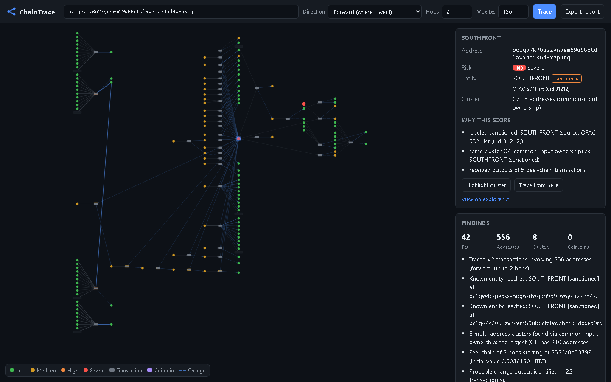

# ChainTrace

**Open-source Bitcoin fund-flow tracing for financial crime investigations.**

Give ChainTrace a transaction or address. It follows the money across multiple hops, groups addresses that likely belong to the same owner, flags laundering patterns, and scores each address for risk, including exposure to **OFAC-sanctioned wallets**. The result is an interactive graph and an investigation report with tamper-evident evidence.

*A forward trace from an address on the U.S. Treasury OFAC SDN list. Risk spreads to cluster members and downstream recipients, and a 5-hop peel chain is detected.*

## Why

Agencies like the FBI, IRS-CI and Treasury trace ransomware payments, sanctions evasion and fraud proceeds on public blockchains, usually with closed, expensive tools such as Chainalysis Reactor. ChainTrace implements the core methods from published research in the open, and every conclusion comes with the reasons behind it so an analyst can check it instead of trusting a black box.

## What it does

- **Multi-hop tracing** forward (where did the funds go?) and backward (where did they come from?), stopping at known entities, CoinJoins and large batch transactions
- **Address clustering** with the common-input-ownership heuristic, excluding CoinJoins that would otherwise merge unrelated users
- **Laundering pattern detection**: change outputs, peel chains and equal-output CoinJoins (Whirlpool, Wasabi, JoinMarket)
- **Explainable risk scores** (0–100) for every address, each with the reasons behind it
- **Sanctions screening** against every crypto address on the OFAC SDN list (1,000+ addresses)
- **Tamper-evident reports** that embed the raw chain data with SHA-256 hashes, so any later change to the evidence is detected

## Results: clustering validated against OFAC

OFAC lists many Bitcoin addresses per sanctioned entity, which gives ground truth for address clustering. ChainTrace pulled the history of all **532 OFAC-sanctioned Bitcoin addresses** (65 entities, 249,771 BTC received) and clustered every transaction that spent from them.

| Metric | Result |
|---|---|
| Sanctioned-address pairs merged into one owner | 748 |
| Pairs that OFAC attributes to the same entity (precision) | **84.4%** |
| Unlisted addresses linked to sanctioned entities, excluding exchange-scale clusters | **12,539** |
| Sanctioned addresses that spent directly into a CoinJoin | 6.1% |

Precision is strict: every merge across two OFAC entries counts as an error, even though OFAC often lists a company and the people behind it as separate entries. Recall is low (6.0% of same-entity pairs), because only the 100 most recent transactions per address were examined and clustering ran one hop out. Linked addresses are leads for investigation and are not published. Full summary: [`results/ofac_study.json`](results/ofac_study.json).

## Tech stack

Python · FastAPI · NetworkX · SQLite · Cytoscape.js · Docker

## Limitations

On-chain heuristics are probabilistic. Results are investigative leads, not proof, and attribution to real people needs corroborating evidence. ChainTrace uses only public blockchain data and public government sanctions lists.

## License

MIT
